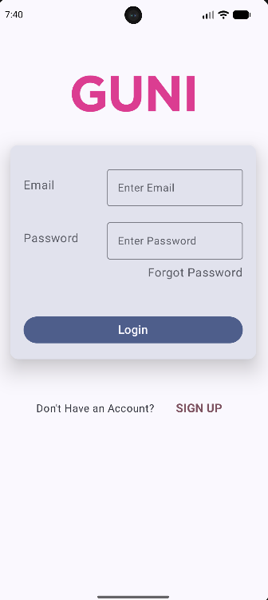
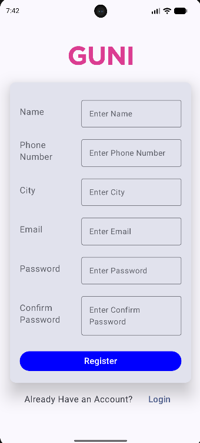

# 📱 Practical-5 — Login and Registration Using Jetpack Compose

## 🎯 Aim

To create an Android application that includes Login and Registration screens using Jetpack Compose.

## 📌 Practical Overview

This practical demonstrates the development of Login and Registration screens using Kotlin and Jetpack Compose in Android Studio. The application features a GUNI-branded interface with user input fields, password fields, buttons, and navigation links between the Login and Registration screens.

## ✨ Features

- Login screen with Email and Password fields
- Registration screen with Name, Phone Number, City, Email, Password, and Confirm Password fields
- Login button on the Login screen
- Register button on the Registration screen
- “Forgot Password?” option on the Login screen
- Navigation from Login to Registration
- Navigation from Registration to Login
- GUNI heading and branded user interface
- UI styling with colors, typography, and spacing

## 🖥️ Screens

### Login Screen

The Login screen includes:

- GUNI heading
- Email input field
- Password input field
- “Forgot Password?” option
- Login button
- “SIGN UP” navigation link for new users

### Registration Screen

The Registration screen includes:

- GUNI heading
- Name input field
- Phone Number input field
- City input field
- Email input field
- Password input field
- Confirm Password input field
- Register button
- “LOGIN” navigation link for existing users

## 🔁 Screen Navigation

```text
        Login Screen
             |
        Tap "SIGN UP"
             |
             v
     Registration Screen
             |
        Tap "LOGIN"
             |
             v
        Login Screen
```

## 🧠 Concepts Covered

- Jetpack Compose
- Declarative UI development
- Composable functions
- Text fields and password fields
- Buttons and clickable text
- Layout arrangement and spacing
- UI styling, colors, and typography
- Login and Registration screen design
- Navigation between screens
- State management for input fields

## 🛠️ Technologies Used

| Technology | Purpose |
|---|---|
| Kotlin | Android application development |
| Jetpack Compose | Building the user interface |
| Android Studio | Development environment |
| Android SDK | Android application platform |
| Navigation Compose | Navigation between screens |
| Git & GitHub | Version control and project hosting |

## 📂 Project Structure

```text
24012011013_MAD_PRACTICAL5/
├── app/
│   ├── src/
│   │   └── main/
│   │       ├── java/
│   │       │   └── com/example/
│   │       ├── res/
│   │       └── AndroidManifest.xml
│   └── build.gradle.kts
├── gradle/
├── .gitignore
├── build.gradle.kts
├── gradle.properties
├── gradlew
├── gradlew.bat
└── settings.gradle.kts
```

## 📝 Updated / Added Files

- `MainActivity.kt` — Main activity of the application.
- `AppNavigation.kt` — Handles navigation between screens.
- `LoginScreen.kt` — Contains the Login screen UI.
- `RegisterScreen.kt` — Contains the Registration screen UI.
- `FormField.kt` — Reusable input field component, if included in the project.
- `app/build.gradle.kts` — App dependencies and build configuration.
- `AndroidManifest.xml` — Application and activity configuration.

## 📸 Screenshots

### 1. Login Screen



### 2. Registration Screen



> **Note:** Add your two actual output screenshots to the `screenshots` folder using the filenames `login.png` and `register.png`.

## ▶️ How to Run

1. Clone or download this repository.
2. Open the project in Android Studio.
3. Wait for Gradle synchronization to finish.
4. Start an Android Emulator or connect an Android device.
5. Click **Run ▶** to launch the application.
6. Test the Login and Registration screens and navigate between them using the provided links.

## ✅ Result

An Android application featuring Login and Registration screens was developed using Kotlin and Jetpack Compose. The application demonstrates form UI design, input fields, buttons, reusable components, and navigation between screens.

---

**Subject:** Mobile Application Development (MAD)  
**Practical:** 5  
**Topic:** Login and Registration Screens Using Jetpack Compose  
**Student Name:** Yash Chaudhary  
**Enrollment Number:** 24012011013  
**Language:** Kotlin  
**Platform:** Android
